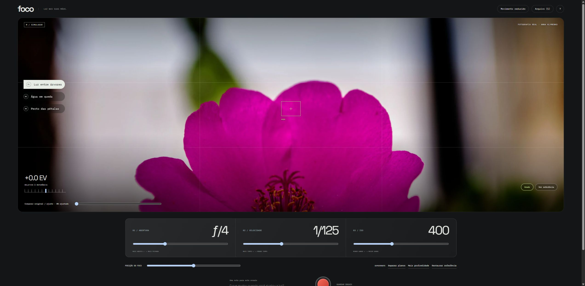

# Foco

Luz nas suas mãos. Um laboratório fotográfico em uma superfície de câmera, com fotos reais, controles de exposição e ensaios locais.

**[Demonstração](https://gustapaz.github.io/foco-optico/)** · Hyperapp + TypeScript + Web Animations API + Vite



## Explore e compare

- Três fotografias reais, troca por uma íris animada e seleção por botões acessíveis.
- Abertura, velocidade, ISO, posição horizontal do foco, grade e três combinações de referência.
- EV relativo à configuração f/4, 1/125 s, ISO 400. Brilho e desfoque periférico ilustrativos, com textura de ruído didática.
- Comparação deslizante original/ajuste e alternância rápida para a referência.
- Até oito ensaios com notas, carregamento de ajustes, remoção e exportação TXT.
- Movimento reduzido pelo sistema ou por controle próprio.

**É uma aproximação didática, não uma câmera real.** Não simula profundidade óptica real, sensor, borrão de movimento ou exposição RAW. Não recupera detalhes ou altera a captura original. EV representa diferença entre ajustes, não uma medição da fotografia. As fotos não são atribuídas aos parâmetros de simulação exibidos.

Sem câmera, API, backend, conta ou dados pessoais. Arquivo local, vazio até criar seus ensaios, sem sincronização. O TXT é um registro legível, sem importação.

## Executar e publicar

Node.js 24.

```sh
npm ci
npm run dev
npm test
npm run check
npm run build
npm run preview
```

Base `/foco-optico/`, exportação estática em `dist`, GitHub Pages gratuito. Hyperapp usa ações e efeitos separados para persistência, downloads e animação. JavaScript comprimido: aproximadamente 7 KB no build validado. Sem fonte ou asset remoto em runtime.

## Licenças

Código MIT, Gustavo Paz. Fotografias reais Pexels: autores, fontes, licenças, transformações e hashes em [docs/assets.json](docs/assets.json), com créditos na interface. Sem imagens geradas por IA ou vínculo com marcas de equipamentos. Licenças do Hyperapp e fontes Space Grotesk / IBM Plex Mono em `docs/`. Assets mantêm suas próprias licenças.

[Direção visual](docs/design.md) · [Validação](docs/validacao.md)
